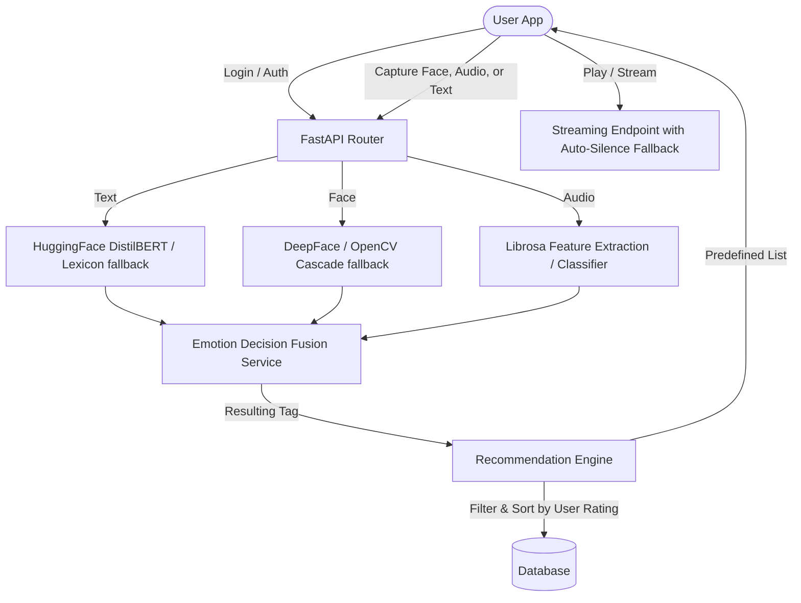

# GenHarmony Project Workflow & Architecture Guide

GenHarmony is a premium multimodal, emotion-driven music intelligence engine. This guide explains how the backend and frontend components integrate, step-by-step workflows for each core feature, and details how datasets are imported and managed.

---

## 1. High-Level Architecture Overview

The system consists of:
1. **Frontend (React / Vite)**: A responsive dark-themed dashboard built with Lucide icons and Tailwind CSS.
2. **Backend (FastAPI / Uvicorn)**: A high-performance Python ASGI application hosting analytical pipelines, ML libraries, and SQLite/PostgreSQL connectors.
3. **Database (SQLAlchemy ORM)**: Stores user details, predefined song libraries, ratings, histories, and AI generation metadata.

---

## 2. Core Workflows (Step-by-Step)

### A. Authentication & Roles
1. **Registration**:
   - New accounts are registered via `/api/v1/auth/register`.
   - By default, users receive the `USER` role.
2. **Login**:
   - Done via `/api/v1/auth/login`.
   - An access token (JWT) is returned containing the user’s ID (`sub`).
3. **Access Admin Portal (One-Click)**:
   - Clicking this on the login screen submits credentials for `admin@genharmony.com`.
   - The backend checks if `admin@genharmony.com` exists. If not, it automatically creates the user with the `ADMIN` role and password `admin123`.

---

### B. Multimodal Emotion Detection
GenHarmony classifies user state into five emotion tags: `HAPPY`, `SAD`, `CALM`, `ANGRY`, `FEAR`.

#### 1. Text Analysis (`TextEmotionService`):
- **ML Pipeline**: Runs text through the Hugging Face `distilbert-base-uncased-emotion` model.
- **Label Mapping**: Maps model output (`joy`/`love` ➔ `HAPPY`; `sadness` ➔ `SAD`; `surprise` ➔ `CALM`; `anger` ➔ `ANGRY`; `fear` ➔ `FEAR`).
- **Lexicon Fallback**: If the model fails, the system scans text for emotion-related keyword lists (e.g. "peaceful" matches `CALM`) and computes percentages.

#### 2. Face Analysis (`FaceEmotionService`):
- **ML Pipeline**: Reads camera snapshots and executes `DeepFace.analyze`.
- **Label Mapping**: Maps raw outputs (`happy` ➔ `HAPPY`; `sad` ➔ `SAD`; `neutral` ➔ `CALM`; `angry`/`disgust` ➔ `ANGRY`; `fear`/`surprise` ➔ `FEAR`).
- **OpenCV Cascade Fallback**: If DeepFace is unavailable, OpenCV Haar Cascade searches for facial presence. If a face is found, it generates deterministic mock scores based on image file size; if no face is found, it defaults to a neutral `CALM` state.

#### 3. Voice/Speech Analysis (`SpeechEmotionService`):
- **Acoustic Extraction**: Loads recorded voice recordings and extracts audio properties using `librosa`:
  - **Loudness**: Root Mean Square (RMS) energy.
  - **Brightness**: Spectral Centroid.
  - **Frequency**: 13 Mel-Frequency Cepstral Coefficients (MFCCs).
- **Heuristic Classifier**:
  - Bright and loud audio ➔ Classified as `HAPPY` or `ANGRY`.
  - Loud and dark audio ➔ Classified as `ANGRY` or `FEAR`.
  - Quiet and warm audio ➔ Classified as `CALM`.
  - Quiet but high centroid audio ➔ Classified as `SAD` or `FEAR`.

#### 4. Emotion Fusion (`EmotionFusionService`):
- Merges all active modality score objects using a weighted decision strategy:
  - **Text Weight**: 35%
  - **Speech Weight**: 35%
  - **Face Weight**: 30%
- If any input modality is missing or offline (e.g., no webcam snapshot), the weights of active inputs are dynamically distributed proportionally.

---

### C. Personalization & Recommendations
1. The frontend requests recommendations from `/api/v1/songs/recommend?emotion=<Tag>`.
2. **Jamendo API Integration**:
   - If `JAMENDO_CLIENT_ID` is configured, the backend queries the Jamendo tracks API (`fuzzytags` search matching mapped emotion tags).
   - Real-time tracks are dynamically saved into the `songs` database table to satisfy foreign-key dependencies (for ratings, likes, and history tracking) before being returned.
   - If Jamendo is unconfigured or fails, the engine falls back to standard songs from the local database.
3. **Personalization Sorting**: The backend retrieves the user's historical ratings and sorts the recommended tracks (live or local), moving highly-rated tracks to the top.

---

### D. Audio Playback & Streaming
1. The frontend streams songs directly from `/api/v1/songs/stream/{song_id}`.
2. **Streaming Redirect**: If the track's path represents a remote Jamendo streaming URL (starts with `http` or `https`), the backend responds with a redirect (`RedirectResponse`), directing the client to play the audio directly from Jamendo.
3. **Self-Healing Silence Generator**: For local files, if the physical audio file is missing on storage, the backend dynamically creates and saves a valid 10-second silent `.wav` file placeholder on disk to prevent player crashes.

---

### E. Admin Song & Dataset Management
Admins can upload files individually or import bulk datasets.

#### CSV Dataset Importing:
1. **Modes**:
   - **Upload CSV File**: Standard browser-side file navigator selector upload.
   - **Local System Path**: Points directly to a local server path (e.g., `C:\Users\DELL\Downloads\music_sentiment_dataset.csv`).
2. **Column Matcher**:
   - Automatically maps incoming headers case-insensitively (`Song_Name` / `name` ➔ `title`; `Artist` ➔ `artist`; `Genre` ➔ `album`; `Mood` / `Sentiment_Label` ➔ `emotion_tag`).
3. **Seeding Logic**:
   - Converts the mapped values to matching standard tags (`Joyful` ➔ `HAPPY`, `Melancholic` ➔ `SAD`, etc.).
   - Checks the database for duplicates of the song (`title` + `artist`) and automatically skips them.
   - Creates a database record and maps the path to auto-created audio files.
