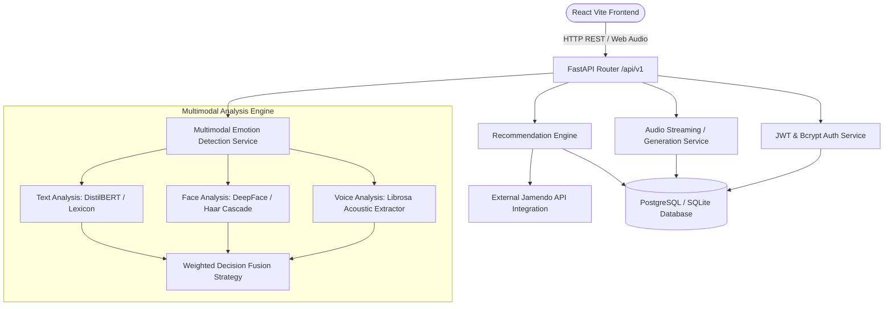
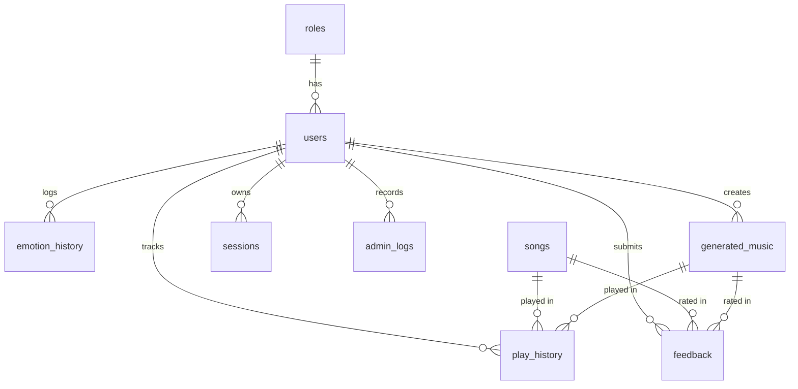

# GenHarmony - Full System Architecture & Database Schema Documentation

GenHarmony is a context-aware, multimodal emotion-driven generative music engine and recommendation platform. This document provides a complete technical specification of the project structure, high-level architecture, decision fusion engine, security mechanisms, API routes, and database schema.

---

## 1. High-Level System Architecture

GenHarmony follows a modular, layer-decoupled architecture comprising:
1. **Frontend (React + Vite + Tailwind CSS)**: Glassmorphic user interface offering real-time emotion capture (Text, Audio, Camera Face API), interactive audio playback, dataset management, and analytics dashboard.
2. **Backend (FastAPI ASGI)**: Asynchronous RESTful service hosting machine learning models, analytical pipelines, emotion fusion algorithms, and streaming media services.
3. **Database Layer (SQLAlchemy ORM + PostgreSQL / SQLite)**: Relational database storing user identities, role-based access controls, song metadata, emotion histories, playback logs, ratings, and AI music metadata.



---

## 2. Full Application Folder Structure

```text
GENHORMONY/
├── PROJECT_WORKFLOW.md          # Workflow & architecture guide
├── README.md                    # Quickstart & setup documentation
├── SYSTEM_ARCHITECTURE.md       # Comprehensive architectural & schema documentation
├── docker-compose.yml           # Multi-container deployment configuration
│
├── backend/                     # FastAPI Backend Application
│   ├── app/
│   │   ├── main.py              # Application entry point, CORS, startup hooks
│   │   ├── ai_models/           # Pre-trained ML model loaders & inference logic
│   │   │   ├── model_loader.py
│   │   │   └── text_emotion.py
│   │   ├── api/                 # REST API Routers
│   │   │   ├── router.py        # Master V1 Router definition
│   │   │   └── v1/              # Endpoint Handlers
│   │   │       ├── auth.py      # /auth (login, register)
│   │   │       ├── emotion.py   # /emotion (text, speech, face, fuse)
│   │   │       ├── feedback.py  # /feedback (ratings & comments)
│   │   │       ├── history.py   # /history (play tracking)
│   │   │       ├── songs.py     # /songs (recommend, stream, generate, csv import)
│   │   │       └── users.py     # /users (profile, role management)
│   │   ├── database/            # Database session & migration scripts
│   │   │   ├── kaggle_seeder.py # CSV dataset auto-importer
│   │   │   ├── seed.py          # Auto-seeder for roles, accounts, and songs
│   │   │   └── session.py       # SQLAlchemy Engine & SessionLocal
│   │   ├── middleware/          # Security & request interceptors
│   │   ├── models/              # SQLAlchemy Database Models
│   │   │   ├── base.py
│   │   │   ├── role.py          # roles table
│   │   │   ├── user.py          # users table
│   │   │   ├── song.py          # songs table
│   │   │   ├── emotion.py       # emotion_history table
│   │   │   ├── generated_music.py # generated_music table
│   │   │   ├── play_history.py  # play_history table
│   │   │   ├── feedback.py      # feedback table
│   │   │   ├── session.py       # sessions table
│   │   │   └── admin_log.py     # admin_logs table
│   │   ├── repositories/        # Data Access Layer (CRUD abstractions)
│   │   │   ├── emotion.py
│   │   │   ├── feedback.py
│   │   │   ├── generated_music.py
│   │   │   ├── song.py
│   │   │   └── user.py
│   │   ├── schemas/             # Pydantic Input/Output Schemas
│   │   │   ├── auth.py
│   │   │   ├── emotion.py
│   │   │   ├── feedback.py
│   │   │   ├── song.py
│   │   │   └── user.py
│   │   ├── services/            # Business Logic Layer
│   │   │   ├── auth.py          # Authentication & auto-healing logic
│   │   │   ├── emotion.py       # Acoustic, vision, and text emotion processing
│   │   │   ├── fusion.py        # Weighted multimodal decision fusion
│   │   │   ├── song.py          # Recommendation algorithms & Jamendo integration
│   │   │   └── user.py          # User management services
│   │   └── utils/               # Utilities & Helpers
│   │       ├── config.py        # Environment settings (Pydantic BaseSettings)
│   │       └── security.py      # Native bcrypt hashing & JWT token handling
│   ├── tests/
│   │   └── test_api.py          # Comprehensive Pytest API test suite
│   └── requirements.txt         # Backend Python dependencies
│
└── frontend/                    # React + Vite Frontend Application
    ├── index.html
    ├── package.json
    ├── vite.config.js
    ├── tailwind.config.js
    └── src/
        ├── App.jsx              # Main App & Router structure
        ├── main.jsx             # React DOM root render
        ├── components/          # Reusable UI components
        │   ├── admin/           # SongManager, DatasetImporter, Analytics
        │   ├── common/          # Header, Sidebar, AudioPlayer, Cards
        │   ├── dashboard/       # EmotionSelector, WebcamModal, VoiceRecorder
        │   └── landing/         # Hero, Features, CTA sections
        ├── context/             # React State Contexts (AuthContext, PlayerContext)
        ├── hooks/               # Custom hooks (useAuth, useEmotion)
        ├── pages/               # Page views (Landing, Login, Register, Dashboard, Admin)
        └── services/            # Axios API wrappers (authService, songService)
```

---

## 3. Database Schema & Entity Relationships

The database consists of **9 tables** linked via foreign key constraints. 



### Complete Table Specifications

#### 1. `roles` Table
Stores system user roles for RBAC.
| Column | Type | Constraints | Description |
| :--- | :--- | :--- | :--- |
| `id` | `VARCHAR(36)` | `PRIMARY KEY` | UUID string identifier |
| `name` | `VARCHAR(50)` | `UNIQUE, NOT NULL, INDEX` | Role name (`ADMIN`, `USER`) |

#### 2. `users` Table
Stores user credentials and profile details.
| Column | Type | Constraints | Description |
| :--- | :--- | :--- | :--- |
| `id` | `VARCHAR(36)` | `PRIMARY KEY` | UUID string identifier |
| `email` | `VARCHAR(255)` | `UNIQUE, NOT NULL, INDEX` | Lowercase email address |
| `hashed_password` | `VARCHAR(255)` | `NOT NULL` | Native `bcrypt` password hash |
| `first_name` | `VARCHAR(100)` | `NULLABLE` | User's first name |
| `last_name` | `VARCHAR(100)` | `NULLABLE` | User's last name |
| `is_active` | `BOOLEAN` | `NOT NULL, DEFAULT TRUE` | Active account status flag |
| `created_at` | `DATETIME` | `NOT NULL, DEFAULT UTC` | Timestamp of account registration |
| `role_id` | `VARCHAR(36)` | `FK -> roles.id (RESTRICT)` | Associated system role ID |

#### 3. `songs` Table
Stores predefined emotion-tagged music track library metadata.
| Column | Type | Constraints | Description |
| :--- | :--- | :--- | :--- |
| `id` | `VARCHAR(100)` | `PRIMARY KEY` | UUID or Jamendo track ID |
| `title` | `VARCHAR(255)` | `NOT NULL` | Track title |
| `artist` | `VARCHAR(255)` | `NOT NULL` | Artist name |
| `album` | `VARCHAR(255)` | `NULLABLE` | Album title or genre tag |
| `file_path` | `VARCHAR(512)` | `NOT NULL` | Audio file path or remote stream URL |
| `emotion_tag` | `VARCHAR(50)` | `NOT NULL, INDEX` | Tag (`HAPPY`, `SAD`, `CALM`, `ANGRY`, `FEAR`) |
| `duration` | `INTEGER` | `NULLABLE` | Track duration in seconds |
| `is_active` | `BOOLEAN` | `NOT NULL, DEFAULT TRUE` | Active track status flag |
| `cover_url` | `VARCHAR(512)` | `NULLABLE` | Cover artwork image URL |
| `created_at` | `DATETIME` | `NOT NULL, DEFAULT UTC` | Creation timestamp |

#### 4. `emotion_history` Table
Logs individual emotion detection results and modal scores.
| Column | Type | Constraints | Description |
| :--- | :--- | :--- | :--- |
| `id` | `VARCHAR(36)` | `PRIMARY KEY` | UUID string identifier |
| `user_id` | `VARCHAR(36)` | `FK -> users.id (CASCADE)` | Target user ID |
| `detected_emotion` | `VARCHAR(50)` | `NOT NULL, INDEX` | Resulting tag (`HAPPY`, `SAD`, etc.) |
| `text_score` | `FLOAT` | `NULLABLE` | Normalized text score (0.0 - 1.0) |
| `speech_score` | `FLOAT` | `NULLABLE` | Normalized speech score (0.0 - 1.0) |
| `face_score` | `FLOAT` | `NULLABLE` | Normalized facial score (0.0 - 1.0) |
| `fusion_score` | `FLOAT` | `NOT NULL` | Combined weighted confidence score |
| `timestamp` | `DATETIME` | `NOT NULL, DEFAULT UTC` | Detection timestamp |

#### 5. `generated_music` Table
Stores metadata for AI-generated ambient audio tracks.
| Column | Type | Constraints | Description |
| :--- | :--- | :--- | :--- |
| `id` | `VARCHAR(36)` | `PRIMARY KEY` | UUID string identifier |
| `user_id` | `VARCHAR(36)` | `FK -> users.id (CASCADE)` | Creator user ID |
| `prompt` | `TEXT` | `NOT NULL` | Generation prompt |
| `emotion_tag` | `VARCHAR(50)` | `NOT NULL, INDEX` | Associated emotion tag |
| `file_path` | `VARCHAR(512)` | `NOT NULL` | Path to generated audio file |
| `created_at` | `DATETIME` | `NOT NULL, DEFAULT UTC` | Timestamp |

#### 6. `play_history` Table
Records track play history for both predefined library songs and generated music.
| Column | Type | Constraints | Description |
| :--- | :--- | :--- | :--- |
| `id` | `VARCHAR(36)` | `PRIMARY KEY` | UUID string identifier |
| `user_id` | `VARCHAR(36)` | `FK -> users.id (CASCADE)` | User ID |
| `song_id` | `VARCHAR(100)` | `FK -> songs.id (CASCADE), NULLABLE` | Played song ID |
| `generated_music_id` | `VARCHAR(36)` | `FK -> generated_music.id (CASCADE), NULLABLE` | Played AI music ID |
| `played_at` | `DATETIME` | `NOT NULL, DEFAULT UTC` | Playback timestamp |

#### 7. `feedback` Table
Stores user ratings and comments for personalized recommendations.
| Column | Type | Constraints | Description |
| :--- | :--- | :--- | :--- |
| `id` | `VARCHAR(36)` | `PRIMARY KEY` | UUID string identifier |
| `user_id` | `VARCHAR(36)` | `FK -> users.id (CASCADE)` | User ID |
| `song_id` | `VARCHAR(100)` | `FK -> songs.id (CASCADE), NULLABLE` | Rated song ID |
| `generated_music_id` | `VARCHAR(36)` | `FK -> generated_music.id (CASCADE), NULLABLE` | Rated AI music ID |
| `rating` | `INTEGER` | `NOT NULL` | Star rating (1 to 5) |
| `comment` | `TEXT` | `NULLABLE` | User feedback text |
| `created_at` | `DATETIME` | `NOT NULL, DEFAULT UTC` | Submission timestamp |

#### 8. `sessions` Table
Tracks active user session tokens.
| Column | Type | Constraints | Description |
| :--- | :--- | :--- | :--- |
| `id` | `VARCHAR(36)` | `PRIMARY KEY` | UUID string identifier |
| `user_id` | `VARCHAR(36)` | `FK -> users.id (CASCADE)` | User ID |
| `token` | `VARCHAR(500)` | `NOT NULL` | JWT Access token string |
| `expires_at` | `DATETIME` | `NOT NULL` | Token expiration timestamp |

#### 9. `admin_logs` Table
Audit trail logging administrative actions.
| Column | Type | Constraints | Description |
| :--- | :--- | :--- | :--- |
| `id` | `VARCHAR(36)` | `PRIMARY KEY` | UUID string identifier |
| `admin_id` | `VARCHAR(36)` | `FK -> users.id (CASCADE)` | Admin user ID |
| `action` | `VARCHAR(255)` | `NOT NULL` | Action code (`UPLOAD_SONG`, etc.) |
| `details` | `TEXT` | `NULLABLE` | JSON or textual details |
| `timestamp` | `DATETIME` | `NOT NULL, DEFAULT UTC` | Action timestamp |

---

## 4. Multimodal Emotion Fusion Strategy

GenHarmony categorizes context into 5 standard emotion states: `HAPPY`, `SAD`, `CALM`, `ANGRY`, `FEAR`.

Inputs are weighted dynamically using proportional decision fusion:
- **Text Analysis Weight**: `35%` (`distilbert-base-uncased-emotion` + Lexicon fallback)
- **Speech/Voice Weight**: `35%` (`Librosa` acoustic spectral centroid, RMS energy, and 13 MFCC coefficients)
- **Facial Analysis Weight**: `30%` (`DeepFace` facial emotion classifier + OpenCV Haar Cascade fallback)

If any modality is offline or disabled, active input weights scale dynamically to total 100%.

---

## 5. Security & Authentication Architecture

- **Native Bcrypt Hashing**: Password hashing uses Python's native `bcrypt` module (`bcrypt.hashpw` with `gensalt()`) for high performance and full compatibility on Python 3.12.
- **JWT Authorization**: Authenticated API endpoints require `Authorization: Bearer <token>` HTTP headers signed via HMAC SHA-256.
- **Self-Healing Default Accounts**: During backend startup or admin login, default accounts (`admin@genharmony.com` / `admin123` and `user@genharmony.com` / `user123`) are auto-created and auto-repaired if passwords differ.

---

## 6. Primary REST API Endpoints Directory

| Category | Method | Endpoint | Access | Description |
| :--- | :--- | :--- | :--- | :--- |
| **Auth** | `POST` | `/api/v1/auth/register` | Public | Register new user account |
| **Auth** | `POST` | `/api/v1/auth/login` | Public | Authenticate user & return JWT token |
| **User** | `GET` | `/api/v1/users/profile` | Authenticated | Retrieve current user profile details |
| **Emotion**| `POST` | `/api/v1/emotion/text` | Authenticated | Analyze text sentiment |
| **Emotion**| `POST` | `/api/v1/emotion/speech` | Authenticated | Analyze audio recording speech features |
| **Emotion**| `POST` | `/api/v1/emotion/face` | Authenticated | Analyze webcam facial snapshot |
| **Emotion**| `POST` | `/api/v1/emotion/fuse` | Authenticated | Compute multimodal weighted fusion |
| **Songs** | `GET` | `/api/v1/songs/recommend` | Authenticated | Get personalized recommendations |
| **Songs** | `GET` | `/api/v1/songs/stream/{id}`| Authenticated | Stream audio file or redirect to Jamendo |
| **Songs** | `POST` | `/api/v1/songs/generate` | Authenticated | Generate contextual AI music track |
| **Songs** | `POST` | `/api/v1/songs/import-csv` | Admin Only | Bulk import music dataset from CSV |
| **Feedback**| `POST` | `/api/v1/feedback/` | Authenticated | Submit song/generated music rating |
